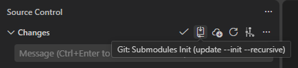
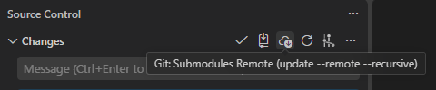

# Git Submodule Update

VS Code extension that adds git submodule update actions to the **Source Control** view: toolbar buttons and a **Submodules** submenu in the `…` menu (alongside Commit, Branch, Pull/Push, and the rest).

| Action | Command | Runs |
| --- | --- | --- |
| Clone icon / menu item | `Git: Submodules Init All` | `git submodule update --init --recursive` |
| Cloud icon / menu item | `Git: Submodules Remote All` | `git submodule update --remote --recursive` |
| Menu / Command Palette | `Git: Submodules Init Selected…` | same as Init, for chosen submodule path(s) |
| Menu / Command Palette | `Git: Submodules Remote Selected…` | same as Remote, for chosen submodule path(s) |





Open **Source Control → … → Submodules** for all-submodule actions or **Init Selected…** / **Remote Selected…** to pick one or more submodules (multi-select Quick Pick). All commands are also available from the Command Palette. Each command runs in the root of the repository the action belongs to (falls back to the first workspace folder), shows progress in the Source Control view, and reports success or the git error as a notification.

## Requirements

- VS Code `^1.80.0`
- `git` available on the `PATH`

## Installation

1. Download the latest `.vsix` from the [Releases](https://github.com/at-besa/git-submodule-update/releases) page.
2. Install it:
   ```sh
   code --install-extension git-submodule-update-<version>.vsix
   ```
   or use **Extensions → … → Install from VSIX…**.

## Development

```sh
npm ci
npm run package   # builds a .vsix in the project root
```

Press `F5` in VS Code to launch an Extension Development Host.

## Releases

Releases are fully automated with [semantic-release](https://github.com/semantic-release/semantic-release) and GitHub Actions on every push to `main`. The version is derived from [Conventional Commits](https://www.conventionalcommits.org/):

| Commit type | Release |
| --- | --- |
| `fix:` | patch (`0.0.x`) |
| `feat:` | minor (`0.x.0`) |
| `feat!:` / `BREAKING CHANGE:` footer | major (`x.0.0`) |
| `docs:`, `chore:`, `refactor:`, … | no release |

On release, the workflow updates `package.json` and `CHANGELOG.md`, tags the commit, builds the `.vsix` and attaches it to the GitHub release.

## License

[GPL-3.0](LICENSE)
